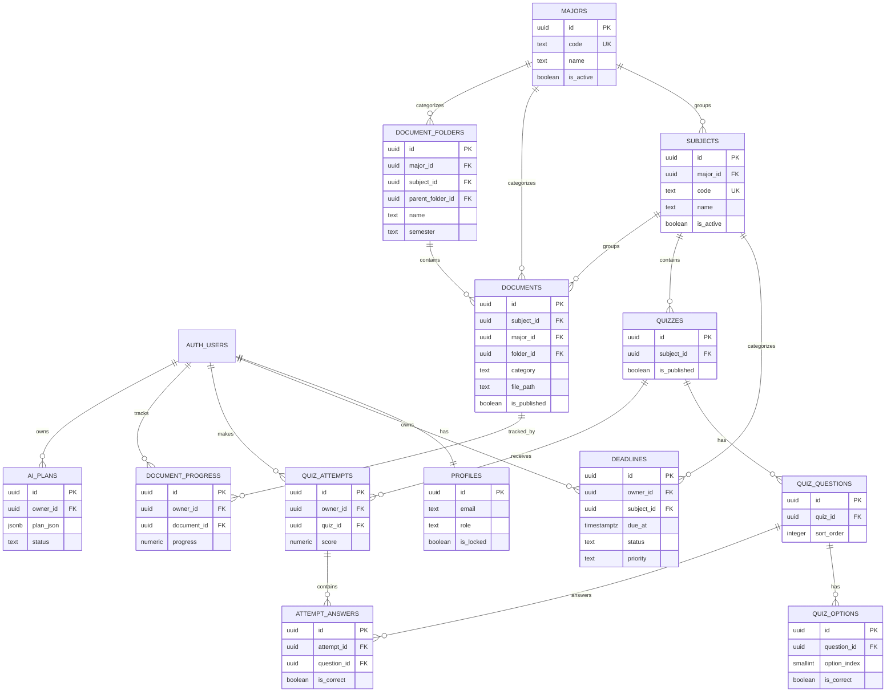

# V-STUDY database design

The Supabase database is PostgreSQL. `profiles.id` is the application profile
for `auth.users.id`; there is no application-facing `public.users` table.

## Migration order

1. `supabase/migrations/202611070001_create_profiles.sql`
2. `supabase/migrations/202611090002_create_core_schema.sql`
3. `supabase/migrations/202611090004_extend_deadlines_for_schedule.sql`
4. `supabase/migrations/202611090005_create_documents_storage.sql`
5. `supabase/migrations/202611160001_user_learning_data.sql`
6. `supabase/migrations/202611230001_admin_account_audit.sql`
7. `supabase/migrations/202611230002_document_folders.sql`
8. `supabase/migrations/202611230003_quiz_modes_and_admin_rpc.sql`
9. `supabase/migrations/202611230004_major_catalog_and_document_scope.sql`
10. `supabase/migrations/202611230005_fix_admin_quiz_question_persistence.sql`
11. `supabase/migrations/202611230006_quiz_option_shuffling.sql`

Run the migrations in order after reviewing them against the live Supabase
schema. The latest admin-account migration adds an immutable admin audit log,
atomic role/lock updates, and an RLS gate for locked users. It must not be
applied until the project owner approves the SQL.
The document-folder migration adds admin-managed folders and tags while
retaining the existing private `documents` Storage bucket and document rows.
The quiz migration adds practice/exam mode and admin-only RPCs for atomic quiz
and question updates. It requires the admin audit-log migration above.
The quiz-persistence fix ensures newly inserted questions are retained while
the RPC removes questions that were intentionally omitted from an edit.
The quiz option migration adds a per-quiz shuffle setting. Flutter randomizes
the four options for each new quiz session and maps answers back to their
stored option indexes for accurate scoring and history.
The major-catalog migration adds a soft-deactivated `majors` catalog, links
subjects to majors, and adds nullable major references to document folders and
documents. Existing rows are preserved and remain unassigned until an admin
classifies them.

## AI quiz generation

The `generate-quiz` Edge Function is deployed to the linked production project.
For a new environment, deploy it after the reviewed database migrations:

```powershell
supabase secrets set GEMINI_API_KEY=your-key
supabase secrets set GEMINI_MODEL=gemini-3.8-flash
supabase functions deploy generate-quiz
```

The Gemini key is stored as a Supabase secret and is never sent to the browser.
The function validates the current user's admin role and locked status, reads
the selected document through the user's RLS-scoped Supabase client, extracts
TXT/DOCX/PPTX text (and lets Gemini read PDF content), then validates the
generated JSON before returning it. Invalid model output is retried once.
Generation supports files up to 15 MB and samples/chunks long extracted text.
New files selected in the admin panel are uploaded into the existing private
`documents` bucket and added to document metadata before generation.

## ERD



## Tables and authorization

- `subjects`: admin-managed subject catalog; authenticated users can read active subjects.
- `majors`: admin-managed major catalog. Admins deactivate entries instead of deleting them, preserving links from subjects and learning materials.
- `deadlines`: student-owned schedule/deadline records. Students can only access their own rows; admins can manage all rows.
- `quizzes`, `quiz_questions`, `quiz_options`: admin-managed content. Students can read only published quizzes and their related content.
- `quiz_attempts`, `attempt_answers`: student-owned quiz history. Answer rows are authorized through their parent attempt.
- `documents`: admin-managed Storage metadata, categorized by optional major, subject, and folder. Students can read only published metadata; Storage bucket policies must use the same publication rule.
- `document_folders`: admin-managed folder hierarchy optionally assigned to a major and subject; deleting non-empty folders is blocked.
- `document_progress`: per-student saved/downloaded/read progress for documents.
- `ai_plans`: per-student cached plans and source snapshots returned by the Edge Function.

All owner tables use `auth.uid()` checks. Admin checks use the existing
`public.is_admin_user()` security-definer function from the profiles migration.
The schema uses `updated_at` triggers and indexes for owner/date, subject,
publication, quiz ordering, attempts, and document progress queries.

Conflict resolution for the later offline-sync phase is last-write-wins by
`updated_at`; this migration does not yet add the local Drift queue.
