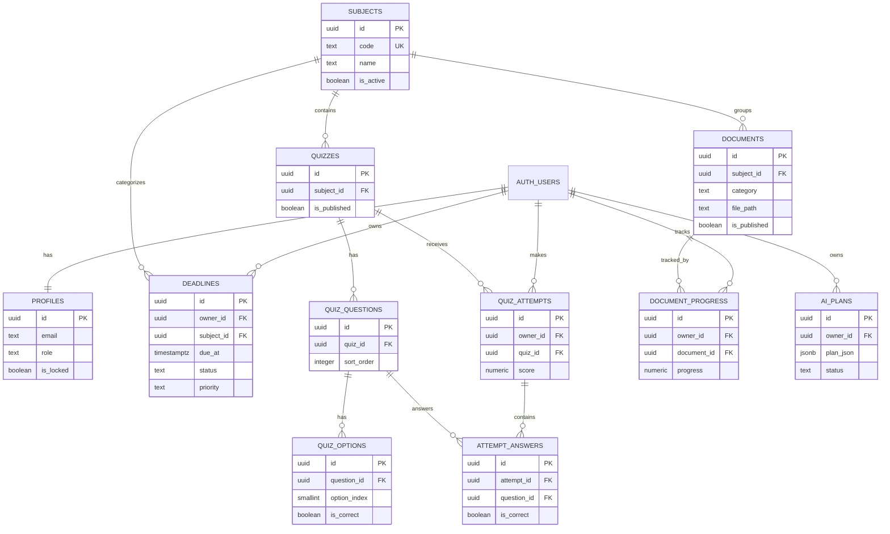

# V-STUDY database design

The Supabase database is PostgreSQL. `profiles.id` is the application profile
for `auth.users.id`; there is no application-facing `public.users` table.

## Migration order

1. `supabase/migrations/202611070001_create_profiles.sql`
2. `supabase/migrations/202611090002_create_core_schema.sql`

Run both files in the Supabase SQL Editor, in this order. The second migration
ends by requesting a PostgREST schema reload.

## ERD

## Tables and authorization

- `subjects`: admin-managed subject catalog; authenticated users can read active subjects.
- `deadlines`: student-owned schedule/deadline records. Students can only access their own rows; admins can manage all rows.
- `quizzes`, `quiz_questions`, `quiz_options`: admin-managed content. Students can read only published quizzes and their related content.
- `quiz_attempts`, `attempt_answers`: student-owned quiz history. Answer rows are authorized through their parent attempt.
- `documents`: admin-managed Storage metadata. Students can read only published metadata; Storage bucket policies must use the same publication rule.
- `document_progress`: per-student saved/downloaded/read progress for documents.
- `ai_plans`: per-student cached plans and source snapshots returned by the Edge Function.

All owner tables use `auth.uid()` checks. Admin checks use the existing
`public.is_admin_user()` security-definer function from the profiles migration.
The schema uses `updated_at` triggers and indexes for owner/date, subject,
publication, quiz ordering, attempts, and document progress queries.

Conflict resolution for the later offline-sync phase is last-write-wins by
`updated_at`; this migration does not yet add the local Drift queue.
